# AXI4-Lite Protocol Peripheral

Basys3 FPGA 위 MicroBlaze SoC에 연결되는 **AXI4-Lite 커스텀 Peripheral IP 5종(GPIO / UART / Timer / I2C / SPI)** 을 직접 설계하고,
계층형 C 소프트웨어 스택과 Stopwatch 응용, GPIO IP에 대한 UVM 검증 환경까지 구축한 프로젝트입니다.

| 항목 | 내용 |
|---|---|
| 기간 | 2026.06.22 ~ 2026.06.30 |
| 형태 | 개인 프로젝트 |
| 보드 | Digilent Basys3 (Artix-7 XC7A35T), 100 MHz |
| 도구 | Vivado / Vitis (MicroBlaze), Xilinx xsim (UVM), Logic Analyzer |

## 핵심 결과

- AXI4-Lite Slave IP **5종**(GPIO / UART / Timer / I2C / SPI) RTL 설계 및 MicroBlaze SoC 통합
- HAL → Driver → Application **계층형 C 소프트웨어**와 1 ms Timer ISR 기반 Stopwatch 응용 구현
- I2C IP: Logic Analyzer로 LCD 주소 `0x27` 접근과 4-bit Nibble mode 데이터 전송의 ACK 확인
- I2C LCD 출력으로 생긴 **17 ms blocking** 문제를 Timer ISR + Flag 구조로 해결
- GPIO IP UVM: **PASS 47 / FAIL 0**

<p align="center">
  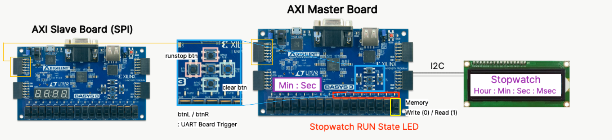
</p>

## System Architecture

```
MicroBlaze ──AXI Interconnect ──┬── gpio_v1_0  ×5  (GPIOA~E: 버튼 / FND / LED …)
                                ├── uart_v1_0      (TX/RX, interrupt)
                                ├── timer_v1_0     (PSC/ARR, 1 ms tick interrupt)
                                ├── I2C_v1_0       (I2C master → PCF8574T/HD44780 LCD)
                                ├── spi_master_v1_0(SPI master → 외부 보드 SPI slave)
                                └── axi_uartlite   (디버그 콘솔)
```

**Memory-Mapped I/O 구조**: 각 IP에 고유 주소 영역을 할당하고, CPU가 레지스터를 읽고 써서 IP를 제어합니다.

<p align="center">
  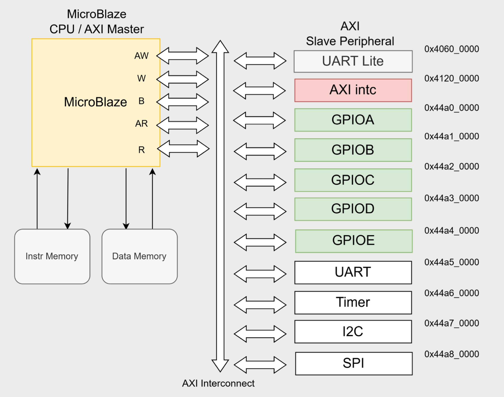
</p>

응용 예제인 **Stopwatch System**은 Timer 인터럽트(1 ms)로 시간을 카운트하고, FND와 I2C LCD에 표시하며,
버튼(Run/Stop, Clear)으로 제어하고 SPI로 다른 Basys3 보드에 값을 전송합니다.

## Repository Layout

```
.
├── Hardware_Vivado/
│   ├── ip_repo/                 # 직접 설계한 AXI4-Lite IP 5종 (Vivado IP packager 형식)
│   │   ├── gpio_1.0/
│   │   ├── uart_1.0/
│   │   ├── timer_1.0/
│   │   ├── I2C_1.0/
│   │   └── spi_master_1.0/
│   │       ├── hdl/             # RTL (*_v1_0.v : top, *_S00_AXI.v : AXI4-Lite slave + register)
│   │       ├── component.xml    # IP-XACT
│   │       ├── xgui/, bd/       # Vivado GUI / BD 스크립트
│   │       └── drivers/, example_designs/  # IP packager 생성물
│   ├── sources_1/bd/system/     # Block design (system.bd) + Xilinx IP 설정(*.xci)
│   ├── constrs_1/               # Basys3 제약 파일 (Basys-3-Master.xdc)
│   └── XSA/system_wrapper.xsa   # Vitis용 하드웨어 플랫폼 (export 결과)
├── vitis_workspace/             # MicroBlaze 소프트웨어 (계층형 구조)
│   ├── hal/                     # 레지스터 직접 접근 계층 (gpio, uart, timer, i2c, spi)
│   ├── driver/                  # 장치 드라이버 (button, fnd, lcd, led, spi)
│   ├── common/                  # delay, interrupt
│   ├── ap/                      # 응용 (stopwatch, spi)
│   └── main.c
├── UVM_GPIO_ip/                 # GPIO IP UVM 검증 환경
│   ├── rtl/                     # DUT (gpio_top.v, gpio_axi.v)
│   └── tb/                      # agent / driver / monitor / scoreboard / coverage / sequence / test
├── spi_slave_HW_code/           # SPI 통신 상대 보드용 SPI slave RTL + xdc
└── docs/                        # README 이미지
```

## Peripheral IP Register Map

모든 IP는 AXI4-Lite slave(32-bit, 4 word) 인터페이스를 가집니다.

| IP | 0x00 | 0x04 | 0x08 | 0x0C | 외부 포트 |
|---|---|---|---|---|---|
| **gpio** | CR (방향) | IDR (입력) | ODR (출력) | – | `io_port[7:0]` (inout) |
| **uart** | SR | TDR | RDR | CR | `tx`, `rx`, `intr` |
| **timer** | CR (bit0 EN, bit1 IE) | PSC | ARR | CNT | `intr` |
| **I2C** | CTRL | ADDR_DATA | RXDATA | STATUS | `scl`, `sda` (inout) |
| **spi_master** | SR | TDR | RDR | CR (CPOL/CPHA/div) | `sclk`, `mosi`, `miso`, `ss_n` |

소프트웨어에서는 각 레지스터 블록을 `typedef struct`로 매핑하고 `XPAR_*_BASEADDR`로 접근합니다
(`vitis_workspace/hal/*/*.h` 참고).

<details>
<summary><b>IP별 블록도 · 레지스터 구조 보기</b></summary>

| GPIO | UART |
|---|---|
| 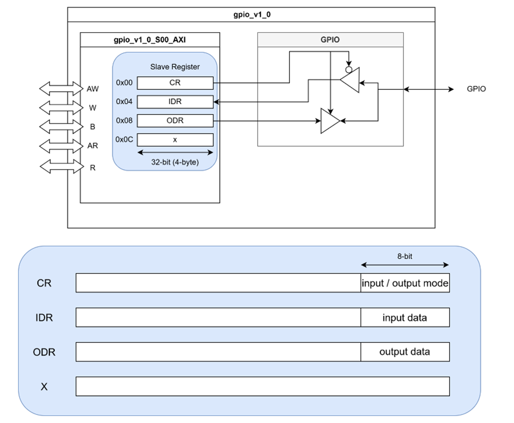 | 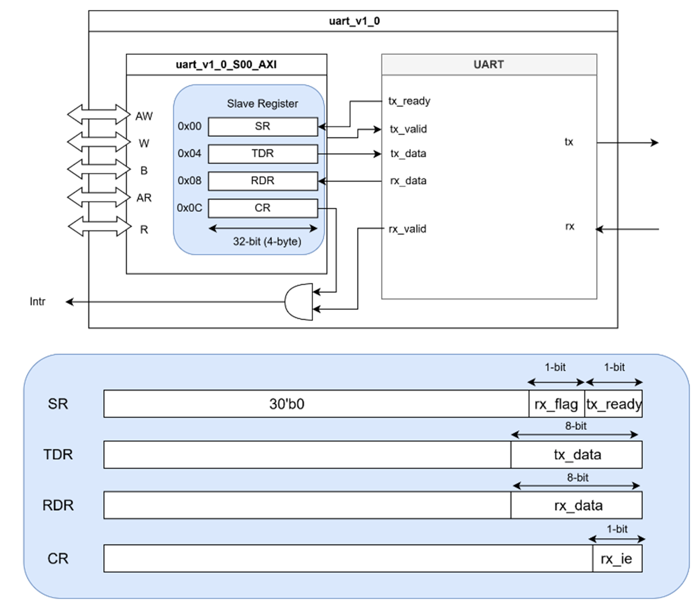 |
| **Timer** | **SPI Master** |
| 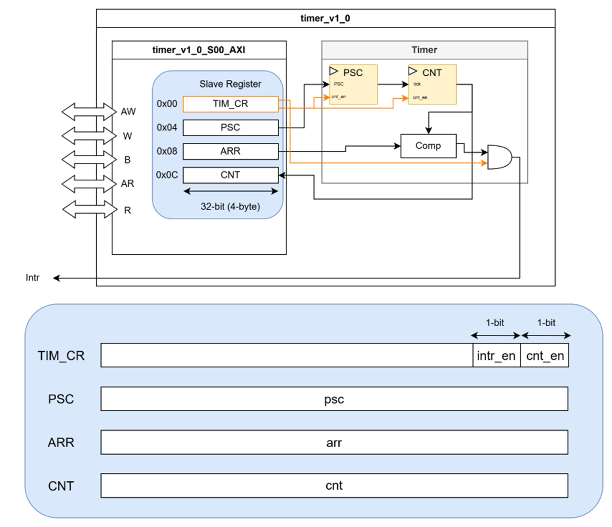 | 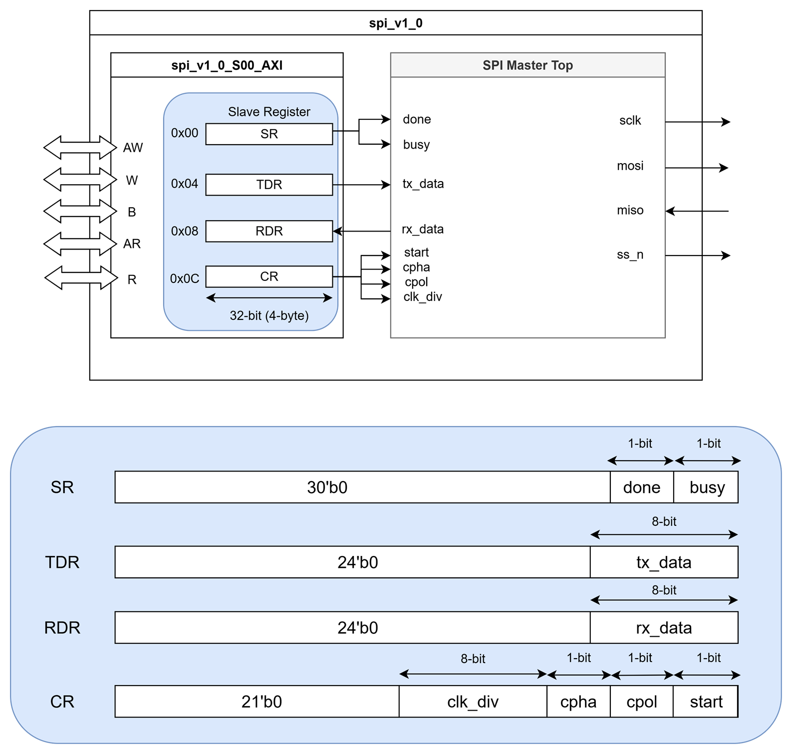 |
| **I2C Master** | |
| 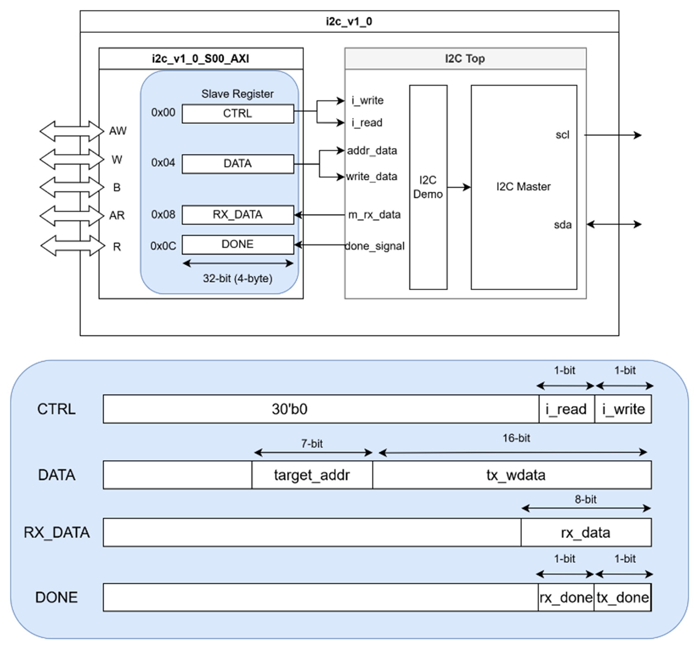 | |

</details>

## Software Stack

```
ap/        Stopwatch, SPI 응용 로직
driver/    Button / FND / LCD(HD44780 via PCF8574T) / LED / SPI
hal/       AXI 레지스터 접근 (GPIO_WritePin, TMR_SetARR, UART_Transmit, …)
common/    delay, interrupt (AXI INTC 연동)
```

<p align="center">
  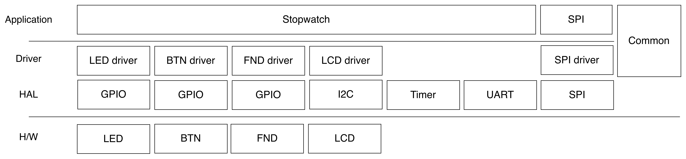
</p>

## Verification

### UVM (GPIO IP)

`UVM_GPIO_ip/`에 AXI4-Lite 인터페이스 기반 UVM 환경을 구성했습니다.

- 구성: `axi4lite_if`, `axi_gpio_seq_item / sequence / driver / monitor / agent / env / scoreboard / coverage / test`
- 검사 항목: B / R 채널 응답(RESP) 확인, Register Map 저장값(Write vs. Read) 확인, Directed Test + Random Transaction 100회
- 시나리오 5종: `gpio_write_seq` · `gpio_read_seq` · `gpio_rw_check_seq` · `gpio_toggle_seq` · `gpio_wstrb_seq`
- 결과: **Scoreboard PASS 47 / FAIL 0**, functional coverage **86.64 %**
  - GPIO IP는 `slv_reg3`(0x0C)를 사용하지 않아 `reg3_addr` Bin이 0 Hit → 사용하는 레지스터(CR · IDR · ODR) Bin은 모두 Hit

| UVM Summary | Address Coverage Bin |
|---|---|
| 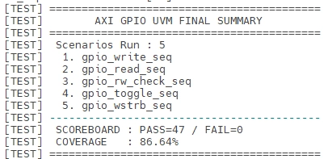 | 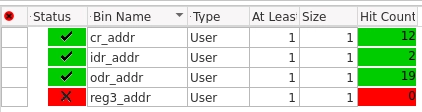 |

<p align="center">
  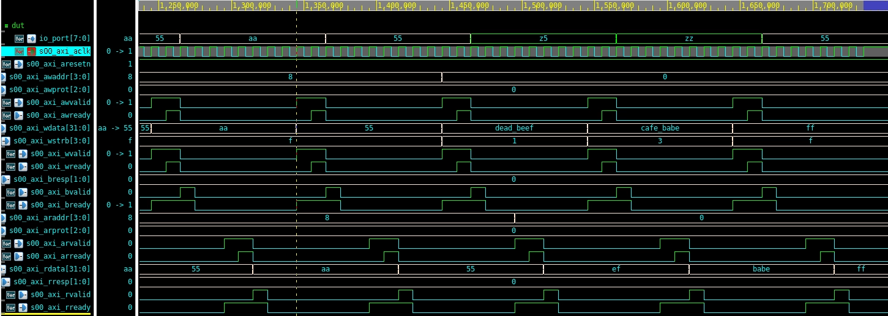
</p>

### Logic Analyzer 실측

| 프로토콜 | 확인 내용 |
|---|---|
| UART | ASCII `'r'` = `0x72` 송신 |
| SPI | Write: `intr(write)` · `addr` · `write data` 순서로 시간 데이터(00:00:10:02) 쓰기 / Read: 같은 주소에서 `read data` 수신 |
| I2C | Slave Address `0x27`(`010_0111`) + Write + ACK 후 LCD Controller 4-bit Nibble mode 데이터(`0x6D 0x69 0x9D 0x99`) + ACK |

- UART

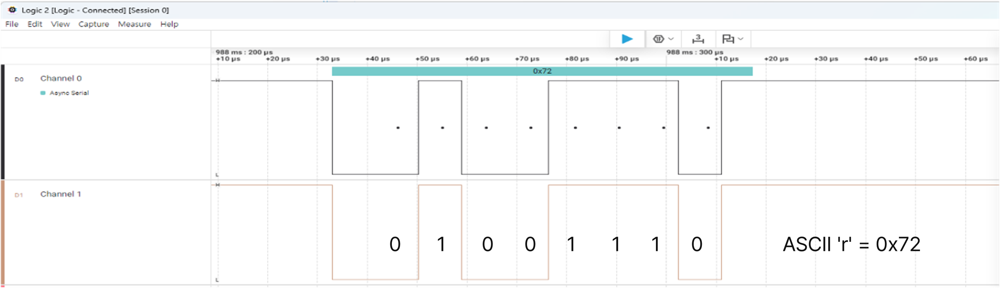

- SPI Write

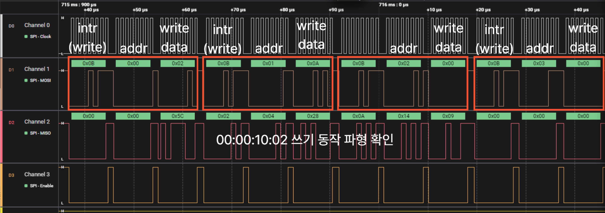

- SPI Read

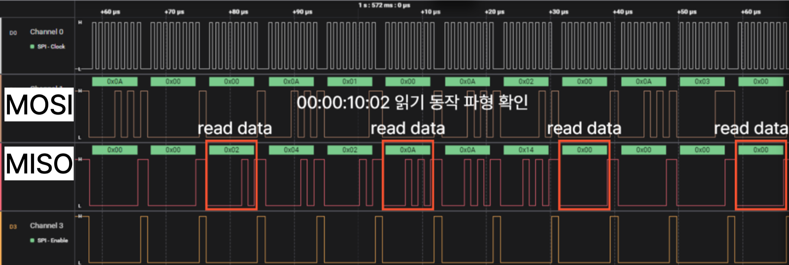

- I2C

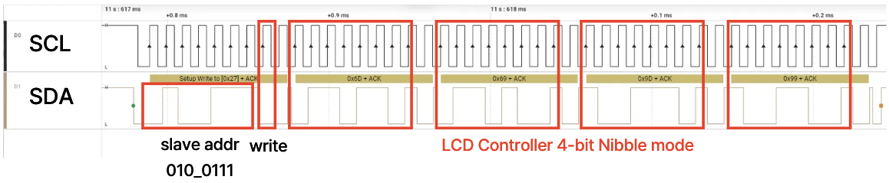

## Trouble Shooting: I2C LCD 추가 후 Button · UART 입력 누락

**현상**: LCD 출력 코드를 추가한 뒤 버튼 입력과 UART 응답이 간헐적으로 끊김

**원인**: LCD 1회 갱신(`LCD_Print`)이 I2C Frame 24회 전송으로 약 **17 ms** 동안 main loop를 막았고,
버튼 처리는 main loop polling 방식이라 그동안 입력을 놓쳤습니다.

```
while(1) → Stopwatch_Execute()
  ├── Button_GetState()        → 버튼 엣지 감지 → UART 송신   ← polling
  ├── Stopwatch_RunTime()
  ├── Stopwatch_ControlState()
  ├── Stopwatch_DispWatch()
  └── LCD_Print() → I2C_LCD_WriteFrame() × 24회 ≈ 17 ms blocking
```

**해결**
1. 버튼 엣지 검출을 1 ms Timer ISR로 이관 → blocking 중에도 버튼 감지
2. Flag 방식 도입: ISR은 500회(500 ms)마다 `g_lcd_update_flag`만 세팅하고, LCD 갱신은 main loop에서만 수행
3. ISR ↔ main loop 공유 변수를 `volatile`로 선언해 캐싱 방지

**결과**: LCD 전송 중에도 버튼 입력을 정상 감지하고, LCD는 500 ms 주기로 정확히 갱신

## How to Reproduce

**Hardware (Vivado)**
1. 새 프로젝트 생성(Basys3) → `Settings > IP > Repository`에 `Hardware_Vivado/ip_repo` 추가
2. `Hardware_Vivado/sources_1/bd/system/system.bd`를 Block Design으로 추가 → HDL wrapper 생성
3. `Hardware_Vivado/constrs_1/imports/OndeviceAI2/Basys-3-Master.xdc` 추가 → Generate Bitstream → Export Hardware(XSA)

**Software (Vitis)**
1. `Hardware_Vivado/XSA/system_wrapper.xsa`로 Platform 생성
2. Application 프로젝트 생성 후 `vitis_workspace/` 내용을 `src/`에 복사

**UVM Simulation (xsim)**
```
cd UVM_GPIO_ip
xvlog -sv -L uvm -i tb rtl/*.v tb/axi4lite_if.sv tb/axi_gpio_pkg.sv tb/tb_top.sv
xelab -L uvm tb_top -s sim
xsim sim -R
```
